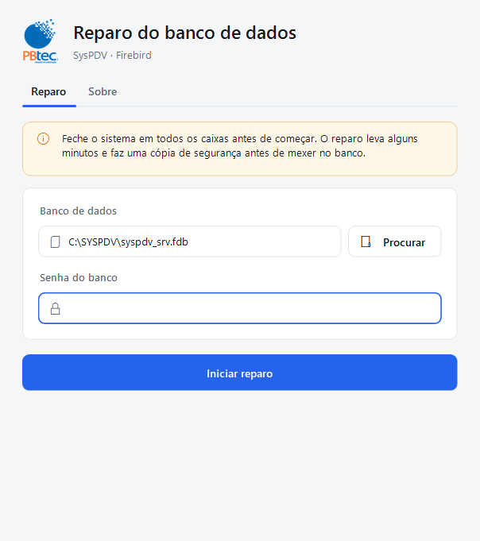
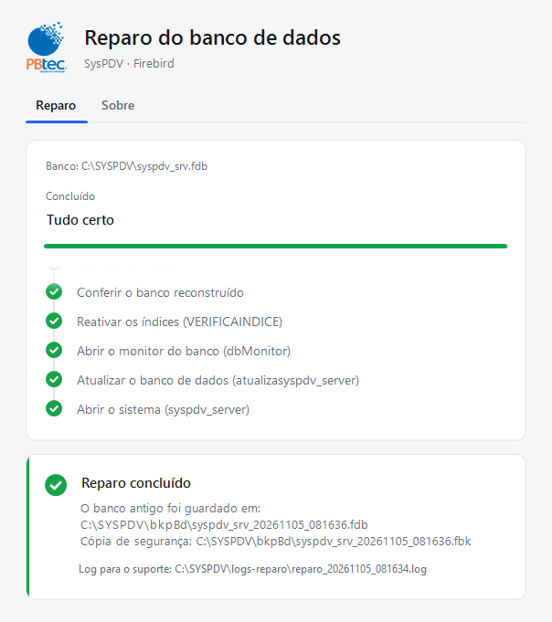

# Reparo SysPDV

Programa para Windows que repara o banco Firebird do SysPDV (`C:\SYSPDV\syspdv_srv.fdb`).
Substitui o antigo `REPARO.CMD` fazendo o mesmo conserto, só que com segurança:

- faz uma cópia de segurança **antes** de mexer no banco e confere se ela deu certo;
- se algo der errado, para e devolve o banco original ao lugar;
- nunca apaga nem sobrescreve backups antigos (data e hora no nome);
- grava tudo num log, sem mostrar a senha;
- uma tela só, simples, pensada para quem está na loja (não precisa saber linha de comando).

<p>
  <picture>
    <source media="(prefers-color-scheme: dark)" srcset="docs/previa-tela/1-inicio-escuro.png">
    
  </picture>
  <picture>
    <source media="(prefers-color-scheme: dark)" srcset="docs/previa-tela/4-sucesso-escuro.png">
    
  </picture>
</p>

> **Atenção:** este programa mexe no banco de dados de uma loja. Teste primeiro numa máquina de
> testes com uma cópia do banco (`docs/teste-real.md`). Nunca rode o `.exe` gerado no computador
> de desenvolvimento.

## Como usar (na loja)

Instruções para o operador: [`src/Reparo.App/LEIA-ME.txt`](src/Reparo.App/LEIA-ME.txt).
Em resumo: fechar o sistema em todos os caixas, abrir o `ReparoSysPDV.exe` como administrador,
escolher o banco, digitar a senha e clicar em **Iniciar reparo**.

## Como compilar

Requisitos: Windows, [.NET 8 SDK](https://dotnet.microsoft.com/download/dotnet/8.0) e
PowerShell 5.1 ou superior.

1. Coloque os programas de terceiros em `terceiros/` (gfix, gbak e fbclient do Firebird 2.5.1,
   VerificaIndice e dbMonitor do SysPDV). Eles **não vêm no repositório**; a lista exata, com
   SHA256, está em [`terceiros/LEIA-ME.md`](terceiros/LEIA-ME.md).
2. Testes de unidade:
   ```powershell
   dotnet test
   ```
3. Testes do reparo completo num ambiente simulado (não toca no banco real):
   ```powershell
   powershell -NoProfile -ExecutionPolicy Bypass -File harness/executar.ps1 -Alvo app
   ```
4. Gerar o pacote para as lojas (`dist/ReparoSysPDV.exe`, um arquivo só, sem instalar .NET):
   ```powershell
   powershell -NoProfile -ExecutionPolicy Bypass -File scripts/publicar.ps1
   ```

## Estrutura

| Pasta/arquivo | Para quê |
|---|---|
| `Reparo.sln`, `Directory.Build.props` | Solução .NET e configurações comuns aos projetos |
| `src/Reparo.Core` | Lógica do reparo, sem tela. Subpastas: `Fluxo` (etapas, desfazer), `Configuracao`, `Firebird` (serviço e detecção), `Sistema` (processos externos, arquivos), `Log` (log e máscara da senha), `Programas` (gfix/gbak etc. embutidos) |
| `src/Reparo.App` | Tela (WinForms), instruções para a loja (`LEIA-ME.txt`) e `reparo.exemplo.json` |
| `tests/Reparo.Testes` | Testes de unidade (xUnit) |
| `harness/` | Ambiente de testes simulado: troca gfix/gbak/net etc. por simuladores ([detalhes](harness/README.md)) |
| `scripts/` | Publicar o `.exe`, gerar ícone, logos e prévias da tela |
| `docs/especificacao.md` | O que o `REPARO.CMD` fazia, os problemas dele e os requisitos do app |
| `docs/decisoes.md` | Registro de decisões (D-001 em diante) |
| `docs/plano.md` | Plano e progresso |
| `docs/teste-real.md` | Roteiro de teste numa máquina de verdade |
| `docs/original/REPARO.CMD` | Script original (referência, não editar) |
| `docs/previa-tela/` | Imagens da tela, geradas por `scripts/previa-tela.ps1` |
| `assets/logos/` | Logos da PBtec usados na tela |
| `terceiros/` | Programas de terceiros embutidos no `.exe` (fora do git) |
| `AGENTS.md`, `CLAUDE.md`, `.github/`, `.claude/`, `.vscode/` | Instruções e comandos para agentes de IA (Copilot, Claude Code) |

## Desenvolvimento com agentes de IA

O projeto foi feito com agentes de IA trabalhando em etapas e validando tudo no harness.
As regras de segurança que eles seguem estão em [`AGENTS.md`](AGENTS.md); os comandos
`/planejar-app`, `/implementar-etapa`, `/rodar-harness` e `/revisar-seguranca` ficam em
`.github/prompts/` (Copilot) e `.claude/commands/` (Claude Code).

## Créditos

PBtec — Soluções em Automação. Equipe: José Henrique, Erick Henrique, Eduardo Vasconcelos.

Firebird é marca da Firebird Foundation. SysPDV e dbMonitor pertencem aos seus respectivos donos;
os programas deles não fazem parte deste repositório.
